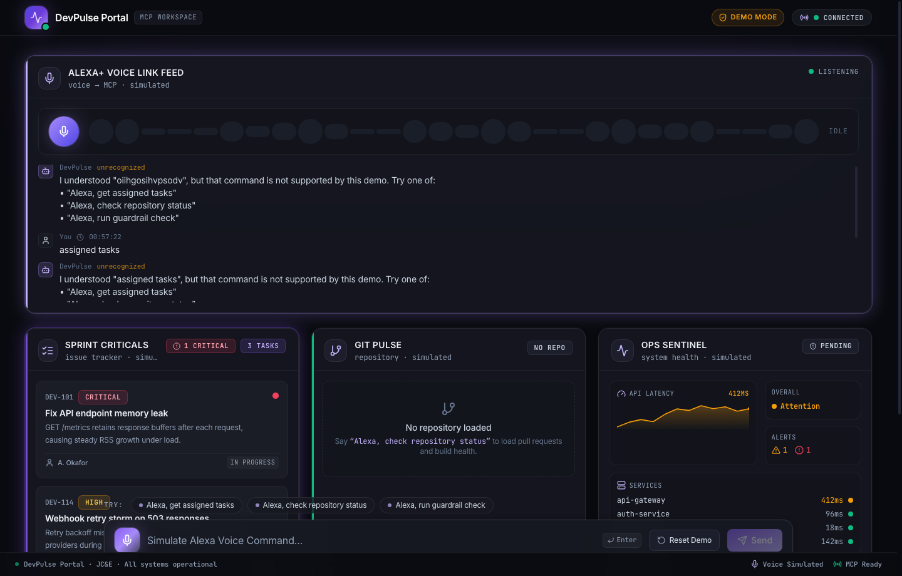
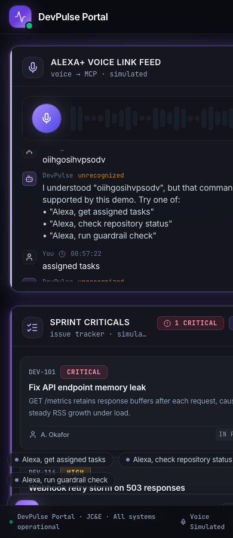
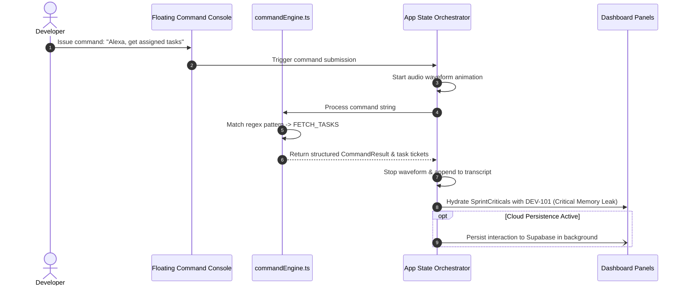
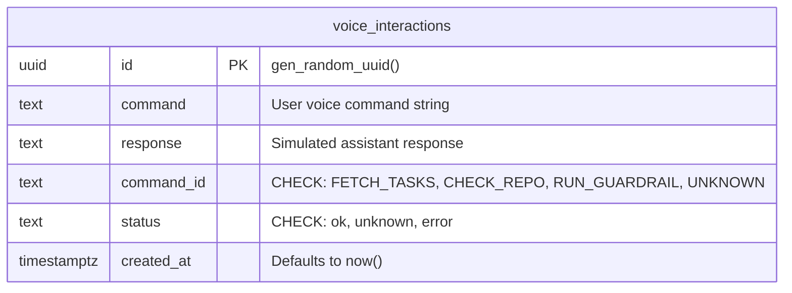

# DevPulse Portal

<div align="center">

**A Voice-Driven Developer Operations Portal Powered by the Model Context Protocol (MCP) Pattern**

[](https://github.com/Adib-07/DevPulse-/actions/workflows/ci.yml)
[](https://github.com/Adib-07/DevPulse-)
[](https://www.typescriptlang.org/)
[](https://react.dev/)
[](https://tailwindcss.com/)
[](https://vitejs.dev/)

[Features](#key-features) • [System Architecture](#system-architecture) • [Demo Walkthrough](#project-demonstration) • [Getting Started](#getting-started) • [Documentation](docs/architecture.md)

</div>

---

## 1. Project Overview

**DevPulse** is a high-output developer portal engineered to eliminate context switching during standups, release reviews, and incident triage. Inspired by an Alexa+-style voice assistant and patterned after Anthropic's **Model Context Protocol (MCP)**, DevPulse aggregates sprint tickets, CI/CD pull request telemetry, and infrastructure observability into a single hands-free developer cockpit.

Built on an engineering-grade **Obsidian Pulse** glassmorphic dark theme, DevPulse delivers glanceable situational awareness. Developers can execute simulated voice commands to retrieve active sprint blockers, audit failing GitHub Actions pipelines, and run automated security guardrails that clear active operational alerts.

---

## 2. Visual Project Preview

### Active Dashboard & Real-Time Voice Link Feed
The active dashboard displays live sprint tickets, CI/CD repository status, API latency telemetry, and the real-time voice link interaction feed with dynamic audio-reactive waveform modulation.


*Figure 1: DevPulse active workspace showing hydrated sprint tickets (`DEV-101`), failing pull request CI details (`PR #247`), operational latency telemetry with SVG Sparklines, and the voice command transcript.*

---

### Clean Workspace State
Upon clean launch or after executing a demo reset, DevPulse presents an unobtrusive, zero-fatigue canvas ready for voice or command-line input.


*Figure 2: DevPulse initial clean state with floating command console and suggested Alexa voice prompts.*

---

### Responsive Mobile Interface
DevPulse adapts seamlessly to mobile viewports (390px–768px), maintaining touch target ergonomics and legible technical telemetry.

<div align="center">
  
  <p><em>Figure 3: DevPulse responsive layout on standard mobile viewport (iPhone 14 / 390px).</em></p>
</div>

---

## 3. Problem Statement

Modern software engineers waste up to **23 minutes refocusing** after each interruption caused by dashboard hopping. During team standups, release sprints, or operational fire drills, engineers are forced to navigate between disparate tools:

* **Issue Trackers (Jira / Linear / Azure Boards):** Context is scattered across multiple backlog views and assignee filters.
* **CI/CD Pipelines (GitHub / Azure DevOps):** Identifying why a PR is failing requires digging through verbose build logs.
* **Observability (Datadog / Prometheus / Azure Monitor):** Latency spikes and degraded microservices live in separate infrastructure graphs.

**DevPulse eliminates this fragmentation** by providing a unified, hands-free conversational interface that surfaces critical sprint blockers, repository health, and system security telemetry on demand.

---

## 4. Solution Overview

DevPulse unifies the developer experience through three core pillars:

1. **Conversational Command Dispatcher:** Accepts natural voice prompts (or developer shorthand) to query engineering tools without opening multiple browser tabs.
2. **Tri-Domain Operational Cockpit:**
   * **Sprint Criticals:** Highlights high-severity blockers with pulsing radar indicators.
   * **Git Pulse:** Alerts engineers to failing CI steps on open pull requests.
   * **Ops Sentinel:** Tracks API latency trends and microservice states.
3. **Resilient Dual-Mode Architecture:** Operates 100% out of the box in local in-memory mode, with automatic upgrade to Supabase cloud persistence and chronological state replay when credentials are configured.

---

## 5. Key Features

| Domain | Feature | Implementation | Status |
| :--- | :--- | :--- | :--- |
| **Voice Interface** | **Alexa+ Voice Link Feed** | Audio-reactive waveform simulation (`Waveform.tsx`), chronological conversation transcript, resolved status badges. | **Implemented** |
| **Command Dispatch** | **Floating Command Console** | Keyboard-accessible (`Enter`), one-click suggested prompt chips, instant demo reset. | **Implemented** |
| **Issue Triage** | **Sprint Criticals** | Categorized ticket priorities (`CRITICAL`, `HIGH`, `MEDIUM`), critical pulsing radar ring, assignee tags. | **Implemented** |
| **CI/CD Telemetry** | **Git Pulse** | Build failure alert shake animation, PR branch and author details, commit hash tracking. | **Implemented** |
| **Observability** | **Ops Sentinel** | Live API latency gauge, dynamic SVG Sparkline history, microservice health list, security clearance sweep banner. | **Implemented** |
| **Protocol Pattern** | **MCP Domain Simulation** | Typed tool dispatching (`FETCH_TASKS`, `CHECK_REPO`, `RUN_GUARDRAIL`) structured for zero-refactor MCP daemon integration. | **Implemented** |
| **Persistence** | **Supabase State Replay** | Asynchronous cloud storage with 4000ms timeout protection (`withTimeout`) and sequential state replay on mount. | **Implemented** |
| **Quality** | **Vitest Automated Suite** | 23 unit and regression tests covering command parsing, replay reducers, and data integrity. | **Implemented** |

---

## 6. System Architecture

DevPulse employs a modular, decoupled architecture separating the presentation layer from domain logic and persistence:

```mermaid
flowchart TD
    subgraph Client["Presentation Layer (React 18 + Vite)"]
        UI["Obsidian Pulse Design Canvas"]
        Console["FloatingCommandConsole<br/>(Voice & Text Dispatcher)"]
        Feed["VoiceLinkFeed<br/>(Waveform & Transcript)"]
        
        subgraph Panels["Domain Cockpit"]
            Sprint["SprintCriticals<br/>(Active Issues)"]
            Git["GitPulse<br/>(CI/CD Health)"]
            Ops["OpsSentinel<br/>(System Telemetry)"]
        end
    end

    subgraph CoreEngine["Simulation & Protocol Layer"]
        Engine["commandEngine.ts<br/>(Intent Classifier)"]
        Types["types.ts<br/>(Typed MCP Contracts)"]
        Replay["persistence.ts<br/>(replayHistory() Reducer)"]
    end

    subgraph Storage["Persistence Options"]
        SupabaseClient["supabaseClient.ts"]
        DB[("Supabase PostgreSQL<br/>voice_interactions")]
        Memory[("Local Memory Fallback<br/>(Zero-Config)")]
    end

    UI --> Console
    Console -->|Raw Command| Engine
    Engine -->|Normalized Regex| Types
    Engine -->|CommandResult| Replay
    Replay -->|State Hydration| Panels
    Engine -->|Transcript Record| Feed

    Replay -.->|async saveInteraction()| SupabaseClient
    SupabaseClient -->|withTimeout 4000ms| DB
    SupabaseClient -.->|No Credentials| Memory
```

*For an in-depth breakdown of components and data contracts, see [docs/architecture.md](docs/architecture.md).*

---

## 7. User Workflow



---

## 8. Tech Stack

| Layer | Technology | Version | Purpose |
| :--- | :--- | :--- | :--- |
| **Frontend Framework** | **React** | `18.3.1` | Component-based UI with declarative state and custom hooks |
| **Language** | **TypeScript** | `5.6.3` | Type-safe domain models, MCP payload contracts, and compile-time verification |
| **Build Tooling** | **Vite** | `7.3.7` | Fast hot module replacement (HMR) and optimized rollup production bundles |
| **Styling** | **Tailwind CSS** | `3.4.1` | Utility-first styling implementing the Obsidian Pulse dark theme |
| **PostCSS** | **Autoprefixer / PostCSS** | `8.4.35` | Vendor prefixing and cross-browser CSS compilation |
| **Iconography** | **Lucide React** | `0.446.0` | Consistent, accessible SVG iconography |
| **Database Client** | **Supabase JS** | `2.57.4` | PostgreSQL persistence with Row-Level Security for interaction history |
| **Testing** | **Vitest** | `5.0.5` | Zero-config unit and regression test runner matching Vite configuration |
| **Code Quality** | **ESLint** | `9.9.1` | Static analysis and TypeScript code standard enforcement |

---

## 9. Microsoft Hackathon Presentation

### Hackathon Evaluation Quick Reference

* **Project Name:** DevPulse Portal
* **Target Audience:** Software Engineering teams, DevOps/SRE specialists, and technical leads.
* **Core Technical Innovation:** Combines conversational AI voice ergonomics (Alexa+ paradigm) with the typed **Model Context Protocol (MCP)** tool dispatch pattern to unify developer triage across issue management, CI/CD, and telemetry.
* **Demonstration Reliability:** 100% reproducible out of the box with zero required external dependencies or API keys.
* **Instant Evaluation URL:** Launch locally and append `?demo=active` to immediately view pre-seeded dashboard states:
  ```
  http://localhost:5173/?demo=active
  ```

### Criteria Alignment

| Evaluation Criteria | DevPulse Implementation |
| :--- | :--- |
| **Innovation & Concept** | Applies conversational voice-first interaction to developer operations, moving away from fragmented, click-heavy dashboard navigation. |
| **Technical Execution** | Fully typed TypeScript contracts, clean state-replay reducers, dynamic audio waveform simulation, and modular architecture structured for live MCP daemon migration. |
| **Usability & UX Design** | High-contrast Obsidian Pulse dark theme designed according to WCAG 2.1 AAA standards; responsive across mobile and desktop. |
| **Reliability & Security** | 23 passing Vitest tests, 0 ESLint warnings, 0 TypeScript errors, timeout-guarded async calls, sanitized `.env.example`, and isolated SVG DOM IDs. |

*Disclaimer: DevPulse is an independent open-source project submitted for hackathon evaluation and is not an official Microsoft product.*

---

## 10. Project Demonstration

Follow this 5-step demonstration sequence to evaluate DevPulse:

```
[Step 1: Clean State] ──> [Step 2: Sprint Triage] ──> [Step 3: CI/CD Health] ──> [Step 4: Security Sweep] ──> [Step 5: Reset / Replay]
```

1. **Inspect Initial Clean State:** Launch the application (`npm run dev`) and note the clean Obsidian workspace with idle status.
2. **Execute Sprint Triage:**
   * Click prompt chip **`Alexa, get assigned tasks`** (or type `get assigned tasks`).
   * *Outcome:* Audio waveform activates; assistant resolves command; **Sprint Criticals** panel hydrates with 3 tickets, highlighting `DEV-101` critical memory leak with a red radar pulse.
3. **Inspect CI/CD PR Status:**
   * Click prompt chip **`Alexa, check repository status`**.
   * *Outcome:* Assistant pulls GitHub status; **Git Pulse** panel triggers `animate-alert-shake` showing PR `#247` failing CI due to test timeouts.
4. **Execute Security Guardrail:**
   * Click prompt chip **`Alexa, run guardrail check`**.
   * *Outcome:* Assistant executes security audit; **Ops Sentinel** displays the green `System Fully Secure` sweep banner, clears active alerts, and reduces simulated API latency to 128ms.
5. **Reset & Replay Verification:**
   * Click **`Reset Demo`** to verify clean state clearing.
   * Reload the page with `?demo=active` to observe automatic chronological replay.

---

## 11. Getting Started

### Prerequisites
* **Node.js:** v18.0.0 or higher (v20+ recommended)
* **npm:** v9.0.0 or higher
* **Git:** v2.30+

### Installation & Run

1. **Clone the repository:**
   ```bash
   git clone https://github.com/Adib-07/DevPulse-.git
   cd DevPulse-
   ```

2. **Install dependencies:**
   ```bash
   npm install
   ```

3. **Configure Environment (Optional):**
   ```bash
   cp .env.example .env
   ```
   *Note: DevPulse runs fully without credentials using its built-in in-memory fallback.*

4. **Start the local development server:**
   ```bash
   npm run dev
   ```
   Open [http://localhost:5173](http://localhost:5173) in your browser.

5. **Run the automated test suite:**
   ```bash
   npm test
   ```

6. **Create a production build:**
   ```bash
   npm run build
   npm run preview
   ```

---

## 12. Environment Variables

DevPulse is zero-config by default. To connect a remote Supabase instance for cloud persistence, configure the following variables in `.env`:

| Variable | Required | Purpose | Safe Example |
| :--- | :---: | :--- | :--- |
| `VITE_SUPABASE_URL` | No | HTTPS endpoint of the Supabase project | `https://your-project.supabase.co` |
| `VITE_SUPABASE_ANON_KEY` | No | Public anonymous client API key | `eyJhbGciOiJIUzI1NiIsInR5cCI6IkpXVCJ9...` |

*Security Rule: Never commit real credentials to Git. See [`.env.example`](.env.example) for placeholder reference.*

---

## 13. Project Structure

```
DevPulse-/
├── .github/
│   └── workflows/
│       └── ci.yml               # GitHub Actions CI workflow (Build, Lint, Test)
├── docs/
│   ├── architecture.md          # In-depth system architecture & protocol specs
│   └── assets/
│       └── screenshots/         # Verified application screenshots
├── src/
│   ├── components/
│   │   ├── CommandConsole.tsx   # Floating voice & text command dispatcher
│   │   ├── GitPulse.tsx         # GitHub repository & CI/CD telemetry card
│   │   ├── Icons.tsx            # Standardized Lucide icon registry
│   │   ├── OpsSentinel.tsx      # System health, latency & guardrail card
│   │   ├── Sparkline.tsx        # Isolated SVG latency trend visualization
│   │   ├── SprintCriticals.tsx  # Active sprint ticket tracker card
│   │   ├── TopNav.tsx           # Glassmorphic top navigation bar
│   │   ├── VoiceLinkFeed.tsx    # Transcript & audio waveform feed
│   │   ├── Waveform.tsx         # Audio-level reactive animated waveform
│   │   └── ui.tsx               # Card, Badge, and Dot primitive components
│   ├── sim/
│   │   ├── commandEngine.ts     # Regex intent parser & MCP dispatcher
│   │   ├── commandEngine.test.ts# Unit tests for command engine (13 tests)
│   │   ├── mockData.ts          # Canonical seed and mock state payloads
│   │   ├── persistence.ts       # Supabase client bridge & replayHistory reducer
│   │   ├── persistence.test.ts  # Unit tests for history replay (6 tests)
│   │   ├── supabaseClient.ts    # Safe client initializer with fallback
│   │   └── types.ts             # Typed MCP domain interfaces
│   ├── App.tsx                  # Root state orchestrator & ambient lighting
│   ├── index.css                # Obsidian Pulse design tokens & utilities
│   └── main.tsx                 # React entry point
├── supabase/
│   └── migrations/              # PostgreSQL schema & Row-Level Security SQL
├── .env.example                 # Safe environment variable template
├── CONTRIBUTING.md              # Contributor guide and PR checklist
├── IMPLEMENTATION_CHECKLIST.md  # Comprehensive engineering audit checklist
├── package.json                 # Project scripts and dependencies
├── SECURITY.md                  # Security policies and vulnerability reporting
├── tailwind.config.js           # Extended Obsidian Pulse theme config
└── vite.config.ts               # Vite configuration with @/ path alias
```

---

## 14. Database & Data Flow

DevPulse includes a production-ready PostgreSQL migration in [`supabase/migrations/20261021151929_create_voice_interactions.sql`](supabase/migrations/20261021151929_create_voice_interactions.sql).

### Entity-Relationship Diagram



* **Index:** `voice_interactions_created_at_idx` on `created_at DESC` for fast retrieval of the latest interactions.
* **Row-Level Security (RLS):** Enabled with `anon_select_voice_interactions` and `anon_insert_voice_interactions` policies.

---

## 15. Testing & Quality Assurance

DevPulse maintains a **100% test pass rate** using Vitest:

```bash
# Run unit & regression test suites
npm test

# Run static type checking
npm run typecheck

# Run linter
npm run lint

# Compile production build
npm run build
```

### Verified Test Results

```
 ✓ src/components/regression.test.ts (4 tests)
 ✓ src/sim/commandEngine.test.ts (13 tests)
 ✓ src/sim/persistence.test.ts (6 tests)

 Test Files  3 passed (3)
      Tests  23 passed (23)
   Duration  154ms
```

---

## 16. Security

* **Zero Hardcoded Secrets:** All code is scanned to ensure no API keys or access tokens are committed.
* **Safe Client Architecture:** The frontend bundle only consumes public client-side keys with least-privilege PostgreSQL RLS policies.
* **Vulnerability Reporting:** See [SECURITY.md](SECURITY.md) for our coordinated disclosure process.

---

## 17. Deployment

DevPulse is structured as an optimized static SPA compatible with:
* **Azure Static Web Apps**
* **Vercel**
* **Netlify**
* **Cloudflare Pages**

**Build Configuration:**
* **Build Command:** `npm run build`
* **Output Directory:** `dist/`
* **Node Version:** 18.x or 20.x

---

## 18. Certificates, Awards & Achievements

DevPulse is currently an active submission in the **Microsoft Hackathon**. 
Official participation certificates, judging milestones, and verified awards will be cataloged in this section upon completion of the evaluation cycle.

---

## 19. Roadmap

- [x] **Phase 1: Core Architecture & Obsidian Pulse UI**
  - [x] Obsidian Pulse dark design system implementation.
  - [x] Voice simulation engine with dynamic waveform modulation.
  - [x] Sprint, Git, and Ops dashboard cockpit panels.
  - [x] Dual-mode local memory and Supabase persistence.
  - [x] Automated Vitest test suite and CI pipeline.
- [ ] **Phase 2: Live Protocol & Integrations**
  - [ ] Real-time Model Context Protocol (MCP) WebSocket / SSE daemon connection.
  - [ ] Web Speech API browser microphone voice capture.
  - [ ] GitHub REST/GraphQL live PR and workflow dispatch integration.
- [ ] **Phase 3: Enterprise & Multi-Tenancy**
  - [ ] Azure Monitor / Application Insights live telemetry webhook ingestion.
  - [ ] GitHub OAuth & multi-tenant user workspace profiles.

---

## 20. Contributing

Contributions are welcome! Please review [CONTRIBUTING.md](CONTRIBUTING.md) for coding standards, branching conventions, and pull request guidelines.

---

## 21. License & Attribution

* **License:** This project is provided for hackathon review under standard open-source evaluation terms. An [MIT License](https://opensource.org/licenses/MIT) is recommended upon open-source release.
* **Typography:** [Inter](https://rsms.me/inter/) by Rasmus Andersson and [JetBrains Mono](https://www.jetbrains.com/lp/mono/) by JetBrains.
* **Icons:** [Lucide React](https://lucide.dev/) under ISC license.

---

## 22. Acknowledgments

* **Anthropic** for pioneering the [Model Context Protocol (MCP)](https://modelcontextprotocol.io/).
* **Vite** and **Tailwind CSS** teams for developer tooling.
* **Supabase** for PostgreSQL serverless persistence.
