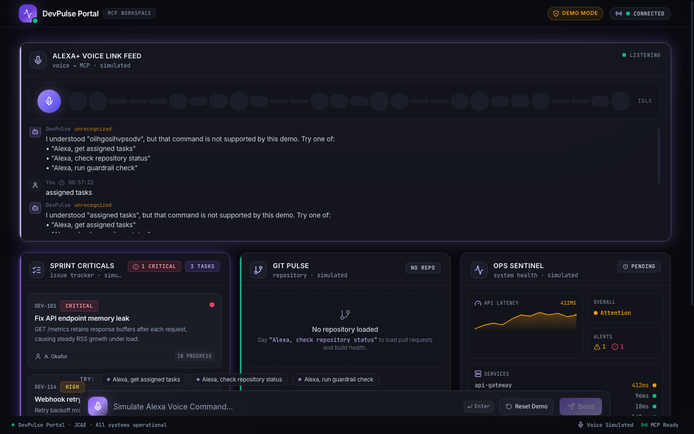
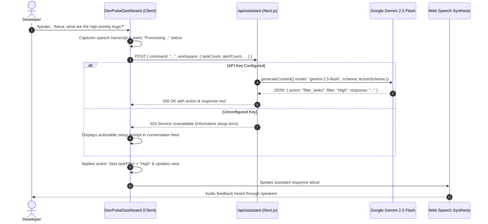

# DevPulse

<div align="center">

**A Voice-Driven Developer Operations Command Center & Model Context Protocol (MCP) Server**

[](https://github.com/Adib-07/DevPulse-/actions/workflows/ci.yml)
[](https://github.com/Adib-07/DevPulse-)
[](https://nextjs.org/)
[](https://react.dev/)
[](https://aistudio.google.com/)
[](https://python.org/)
[](https://modelcontextprotocol.io/)
[](https://www.typescriptlang.org/)
[](https://pnpm.io/)
[](https://vercel.com/)

[Overview](#product-overview) • [Key Features](#key-features) • [Visual Showcase](#visual-product-showcase) • [Tech Stack](#tech-stack) • [System Architecture](#system-architecture) • [Getting Started](#installation--local-development) • [API Reference](#api-documentation) • [MCP Server](#python-mcp-server-reference) • [Verification](#testing--quality-assurance)

</div>

---

## Hero Presentation

DevPulse is a full-stack developer operations command center designed to eliminate context switching and cognitive overload during standups, release reviews, and incident triage.

Instead of navigating fragmented browser tabs across Jira backlogs, GitHub pull requests, and infrastructure monitoring dashboards, DevPulse provides an **Alexa-style conversational voice interface** and a typed **Model Context Protocol (MCP)** server that aggregates, filters, and resolves operational engineering telemetry in real time.


*Figure 1: DevPulse Command Center running on the Obsidian Pulse dark design system, displaying active sprint tickets, system alerts, repository health, and simulated voice logs.*

---

## Product Overview

### The Problem
Modern software engineers lose up to **23 minutes refocusing** every time they are interrupted by dashboard fragmentation. During sprint standups, code freezes, or production incidents, developers must constantly switch contexts between:
1. **Issue Trackers (Jira / Linear):** Searching through dense backlogs for assigned blockers.
2. **Version Control & CI/CD (GitHub):** Identifying why PR checks are failing or which reviews are pending.
3. **Observability & Health (Datadog / CloudWatch):** Tracking high-severity service alerts and latency spikes.

### The Solution
DevPulse unifies these three critical domains into a hands-free conversational interface and an open standard protocol:
* **Frontend Command Portal (Next.js 16 + React 19):** An accessible, voice-enabled web HUD built with Web Speech API recognition, Web Speech synthesis, and the high-contrast Obsidian Pulse theme.
* **AI Voice Assistant Route (`/api/assistant`):** A server-side API powered by Google Gemini 2.5 Flash that parses natural developer commands into structured JSON actions with prompt injection protection.
* **Backend MCP Server (`server.py`):** An official Python Model Context Protocol v2 server exposing standardized tools (`get_assigned_tasks`, `get_repo_alerts`, `trigger_code_review`) over stdio transport for direct integration with AI developer tools like Claude, Cursor, and VS Code Copilot.

### Value Proposition
* **Hands-Free Standup Updates:** Ask *"Alexa, what are the top two high-priority bugs assigned to me?"* and immediately hear and see the filtered tickets.
* **Instant Incident Triage:** Identify failing CI checks and critical database CPU spikes on a single dashboard, with 1-click resolution actions.
* **100% Reproducible & Resilient:** Runs entirely out of the box with seeded local telemetry datasets (`tasks.json`, `github.json`, `alerts.json`) while supporting live Gemini API keys and cloud persistence when configured.

---

## Key Features

### Implemented & Verified

| Feature | User Interaction | Behind the Scenes | Implementation Status |
| :--- | :--- | :--- | :--- |
| **Conversational Voice Command HUD** | Click the floating microphone button or press `Enter` to speak or type commands. | Uses browser `SpeechRecognition` and `speechSynthesis`, with fallback to text input. | **Verified** ([`components/devpulse-dashboard.tsx`](components/devpulse-dashboard.tsx)) |
| **Gemini AI Intent Classification** | Natural voice input (e.g. *"Show critical alerts"*, *"Filter sprint tasks"*) is sent to `/api/assistant`. | Calls Google Gemini 2.5 Flash with strict JSON schema output, input bounding (500 chars), and prompt injection delimiters. | **Verified** ([`app/api/assistant/route.ts`](app/api/assistant/route.ts)) |
| **Sprint Task Cockpit** | Filter tasks by priority (`Critical`, `High`, `Medium`), execute live search queries, and toggle expanded views. | React 19 state filters `tasks` with type-safe priority badges and assignee avatars. | **Verified** ([`components/devpulse-dashboard.tsx`](components/devpulse-dashboard.tsx)) |
| **Live System Alert Sentinel** | Filter alerts by severity (`Critical`, `Warning`, `Info`, `Resolved`) and click **Resolve** on active incidents. | State-managed alert records with `event.stopPropagation()` guard and "Clear resolved alerts" action. | **Verified** ([`components/devpulse-dashboard.tsx`](components/devpulse-dashboard.tsx)) |
| **Repository & CI/CD Health** | Inspect default branch, latest commit hash, issue count, and passing/failing CI check ratios. | Telemetry card tracking GitHub status with type-safe tone styling maps. | **Verified** ([`components/devpulse-dashboard.tsx`](components/devpulse-dashboard.tsx)) |
| **Pull Request Review Stream** | Monitor open pull requests and review statuses (`Review requested`, `Approved`, `Checks failing`). | Dedicated panel integrated into a balanced 2-column grid alongside system alerts. | **Verified** ([`components/devpulse-dashboard.tsx`](components/devpulse-dashboard.tsx)) |
| **Python MCP Server** | Connect external AI tools (Claude Desktop, MCP Inspector) via stdio. | Implements official Python SDK `mcp[cli]>=2.0,<3` exposing 3 developer tools. | **Verified** ([`server.py`](server.py)) |
| **Data Contract Schemas** | Shared mock datasets simulating real engineering operations. | Validated JSON files (`tasks.json`, `github.json`, `alerts.json`) with automated contract test coverage. | **Verified** ([`tests/data-contracts.test.ts`](tests/data-contracts.test.ts)) |
| **Vercel Deployment Compatibility** | 1-click continuous deployment from GitHub main. | Authoritative [`vercel.json`](vercel.json) root configuration with Next.js webpack compilation. | **Verified** ([`vercel.json`](vercel.json)) |

### Implemented with Configuration

* **Live Google Gemini 2.5 Flash:** Activated automatically when `GEMINI_API_KEY` or `API_KEY` is present in the environment. Returns controlled 503 Service Unavailable with setup guidance when unconfigured.
* **Optional Cloud Database Persistence:** Supabase PostgreSQL integration schema provided in [`supabase/migrations/`](supabase/migrations/) for storing interaction history when cloud credentials are provided.

### Planned & Future Capabilities

* [ ] Direct bidirectional WebRTC audio streaming to Gemini Live Multimodal WebSocket API.
* [ ] Inbound GitHub App webhook receiver (`/api/webhooks/github`) for push-based PR event telemetry.
* [ ] Direct AWS CloudWatch metric alarms ingestion endpoint.

---

## Visual Product Showcase

### 1. Active Workspace & Voice Link Stream
When commands are issued, DevPulse captures the transcript, classifies the intent, triggers synthesized voice playback, and updates the relevant cockpit card in real time.


*Figure 2: Active DevPulse session showing conversation history, live task prioritization (`DEV-241`), and incident triage feed.*

---

### 2. Mobile Responsive Layout
DevPulse is fully responsive, maintaining touch-target ergonomics, legible telemetry, and collapsible mobile sidebar navigation across viewports as small as 390px width.

<div align="center">
  
  <p><em>Figure 3: DevPulse responsive layout running on mobile viewport (390px × 844px).</em></p>
</div>

---

## Tech Stack

| Technology | Category | Version | Purpose in DevPulse |
| :--- | :--- | :--- | :--- |
| **Next.js** | Full-Stack Framework | `16.4.2` | App Router architecture, server-side `/api/assistant` route, static shell generation, and Webpack production bundling. |
| **React** | UI Library | `19.2.4` | Declarative UI state management, custom hooks, and concurrent client hydration. |
| **TypeScript** | Language | `5.7.3` | Compile-time type safety across routes, component props, and test suites (`tsc --noEmit`). |
| **Google GenAI SDK** | AI Integration | `2.30.0` | Server-side invocation of `gemini-2.5-flash` with structured JSON schema output and prompt isolation. |
| **Tailwind CSS** | Styling | `4.3.3` | Utility-first CSS using `@theme` inline tokens to implement the Obsidian Pulse design system. |
| **PostCSS** | CSS Processing | `8.5.6` | Modern CSS transformation via `@tailwindcss/postcss`. |
| **Lucide React** | Iconography | `1.17.0` | Accessible, consistent SVG icons across navigation, telemetry badges, and metric cards. |
| **Base UI** | Component Primitives | `1.5.0` | Headless, accessible button primitives (`@base-ui/react/button`). |
| **Python** | Backend Server | `3.11+` | Runtime for the Model Context Protocol (MCP) server. |
| **MCP Python SDK** | Protocol Standard | `>=2.0,<3` | Official `mcp[cli]` implementation exposing tools to AI clients over stdio. |
| **Node.js Test Runner** | Testing | Built-in | Native ESM and TypeScript test execution (`node --test --experimental-strip-types`) in <100ms. |
| **pnpm** | Package Manager | `11.17.0` | Fast, deterministic dependency installation with supply-chain policy verification. |
| **Vercel** | Deployment Platform | Production | Automated CI/CD deployment configured via [`vercel.json`](vercel.json). |

---

## System Architecture

DevPulse is structured into two complementary tiers that share a unified data contract:

```
                      ┌────────────────────────────────────────────────────────┐
                      │                DEVELOPER VOICE & INPUT                 │
                      │       Web Speech API Recognition / Keyboard Input      │
                      └───────────────────────────┬────────────────────────────┘
                                                  │
                                                  ▼
┌──────────────────────────────────────────────────────────────────────────────────────────────────────────┐
│                                       NEXT.JS 16 APPLICATION TIER                                        │
│                                                                                                          │
│   ┌────────────────────────────────────────────────────────┐   POST /api/assistant   ┌─────────────────┐ │
│   │            DevPulseDashboard (React 19 Client)         ├────────────────────────►│  Route Handler  │ │
│   │  ├─ Interactive Sprint Tasks (Filter & Search)         │◄────────────────────────┤  (Gemini 2.5)   │ │
│   │  ├─ Live System Alerts (Severity Triage & Resolve)     │   JSON Action Schema    └────────┬────────┘ │
│   │  ├─ Repository Health (Checks, Commits, Issues)        │                                  │          │
│   │  └─ Pull Requests Review Triage                        │                                  ▼          │
│   └────────────────────────────────────────────────────────┘                         ┌─────────────────┐ │
│                                                                                      │ Google GenAI    │ │
│                                                                                      │ gemini-2.5-flash│ │
│                                                                                      └─────────────────┘ │
└───────────────────────────────────────────────────┬──────────────────────────────────────────────────────┘
                                                    │
                                                    │ Shared Data Contracts
                                                    │ (tasks.json / github.json / alerts.json)
                                                    ▼
┌──────────────────────────────────────────────────────────────────────────────────────────────────────────┐
│                                   PYTHON MCP SERVER (Stdio Transport)                                    │
│                                                                                                          │
│   ├─ get_assigned_tasks     ──► Reads Jira sprint tasks via data_loader.py                               │
│   ├─ get_repo_alerts        ──► Reads system monitoring & CI checks via data_loader.py                   │
│   └─ trigger_code_review    ──► Simulates automated pull request check analysis                          │
└──────────────────────────────────────────────────────────────────────────────────────────────────────────┘
```

---

## Core Workflow Sequence

The diagram below illustrates the exact sequence when a developer issues a voice command:



---

## Repository Structure

```
DevPulse-/
├── app/
│   ├── api/
│   │   └── assistant/
│   │       └── route.ts         # Server-side Gemini AI assistant route handler
│   ├── globals.css              # Tailwind CSS v4 variables & Obsidian dark theme
│   ├── layout.tsx               # Root Next.js layout, metadata, viewport, favicons
│   └── page.tsx                 # Application entry point rendering DevPulseDashboard
├── components/
│   ├── ui/
│   │   └── button.tsx           # Accessible button primitive using @base-ui/react
│   └── devpulse-dashboard.tsx   # Interactive DevPulse command center dashboard
├── docs/
│   ├── architecture.md          # In-depth architectural & protocol specification
│   ├── assets/
│   │   └── screenshots/         # Verified application screenshots
│   └── images/                  # Standardized documentation image assets
├── lib/
│   └── utils.ts                 # Classnames merge utility (cn) using clsx & twMerge
├── public/                      # Static branding, favicons, and SVG icons
├── tests/
│   ├── api-assistant.test.ts    # Route tests for /api/assistant (validation, 503, auth)
│   ├── data-contracts.test.ts   # Schema validation for tasks, github, and alerts JSON
│   ├── regression-engine.test.ts# Intent classification & wake word stripping tests
│   └── utils.test.ts            # Unit tests for Tailwind merge helper
├── .env.example                 # Sanitized environment template (no secrets)
├── .github/
│   └── workflows/
│       └── ci.yml               # GitHub Actions CI matrix (pnpm, Node 22, Python 3.11)
├── .gitignore                   # Exclusions for .env, .next, node_modules, Python cache
├── AGENTS.md                    # Guidelines for autonomous engineering agents
├── CONTRIBUTING.md              # Contributor guidelines and branch standards
├── SECURITY.md                  # Security policies and coordinated vulnerability disclosure
├── alerts.json                  # Mock monitoring alerts & microservice health dataset
├── data_loader.py               # Python JSON reader & validation module
├── github.json                  # Mock pull request & CI status dataset
├── next.config.mjs              # Hardened Next.js configuration (unoptimized images)
├── package.json                 # Project dependencies, scripts, and package manager
├── pnpm-lock.yaml               # Authoritative frozen dependency lockfile
├── requirements.txt             # Python dependencies (mcp[cli]>=2.0,<3)
├── server.py                    # Official Python MCP server implementation
├── tasks.json                   # Mock developer sprint tasks dataset
├── tsconfig.json                # TypeScript configuration with @/* path aliases
└── vercel.json                  # Authoritative Vercel deployment configuration
```

---

## Installation & Local Development

### Prerequisites
* **Node.js:** `v20.0.0` or higher (verified on Node `v22` and `v26`)
* **pnpm:** `v9.0.0+` (verified on `pnpm@11.17+`)
* **Python:** `v3.11` or higher (for the MCP server)
* **Git:** `v2.30+`

---

### Part A: Running the Frontend Operations Portal

1. **Clone the repository:**
   ```bash
   git clone https://github.com/Adib-07/DevPulse-.git
   cd DevPulse-
   ```

2. **Install frontend dependencies:**
   ```bash
   pnpm install
   ```

3. **Configure Environment Variables (Optional):**
   ```bash
   cp .env.example .env.local
   # Set GEMINI_API_KEY to enable live AI voice command processing
   ```
   *Note: DevPulse dashboard operates 100% locally out of the box in demo mode.*

4. **Start the Next.js development server:**
   ```bash
   pnpm dev
   ```
   Open [http://localhost:3000](http://localhost:3000) in your browser.

5. **Run the automated test suite:**
   ```bash
   pnpm test
   ```

6. **Validate TypeScript & compile production build:**
   ```bash
   pnpm typecheck
   pnpm build
   pnpm start
   ```

---

### Part B: Running the Python MCP Server

The repository includes a standalone Model Context Protocol server exposing developer tools over stdio:

1. **Create and activate a virtual environment:**
   ```bash
   python3 -m venv .venv
   source .venv/bin/activate  # On Windows: .venv\Scripts\activate
   ```

2. **Install MCP dependencies:**
   ```bash
   pip install -r requirements.txt
   ```

3. **Run the MCP server directly:**
   ```bash
   python server.py
   ```
   *(The server runs over stdio and waits for an MCP client).*

4. **Interactive testing with the official MCP Inspector:**
   ```bash
   mcp dev server.py
   ```
   The Inspector opens a local web interface where you can test the three exposed tools:
   * `get_assigned_tasks`: Returns formatted sprint tickets from `tasks.json`.
   * `get_repo_alerts`: Returns active monitoring alerts and failing CI checks from `alerts.json` and `github.json`.
   * `trigger_code_review`: Analyzes PR test failures and returns actionable triage steps.

---

## Environment Variables

| Variable | Required | Purpose | Exposure |
| :--- | :---: | :--- | :--- |
| `GEMINI_API_KEY` | Optional | API key for Google Gemini 2.5 Flash voice command parsing | **Server-Only** (Never exposed to browser) |
| `API_KEY` | Optional | Fallback variable alias for `GEMINI_API_KEY` | **Server-Only** |
| `NEXT_PUBLIC_SUPABASE_URL` | Optional | HTTPS endpoint for Supabase PostgreSQL persistence | Public client bundle |
| `NEXT_PUBLIC_SUPABASE_ANON_KEY` | Optional | Public anonymous key for Supabase client queries | Public client bundle |

*Security Rule: Real API credentials must never be committed. See [`.env.example`](.env.example) for placeholder values.*

---

## API Documentation

### Assistant Route: `/api/assistant`

#### 1. Endpoint Health Probe
* **Method:** `GET`
* **Authentication:** None
* **Description:** Returns the operational status of the voice assistant route and indicates whether Gemini is configured.
* **Response `200 OK`:**
  ```json
  {
    "status": "online",
    "endpoint": "/api/assistant",
    "model": "gemini-2.5-flash",
    "geminiConfigured": true,
    "allowedActions": ["overview", "tasks", "repository", "pull_requests", "alerts", ...]
  }
  ```

#### 2. Process Command
* **Method:** `POST`
* **Authentication:** None (Uses server-side `GEMINI_API_KEY`)
* **Request Headers:** `Content-Type: application/json`
* **Request Body:**
  ```json
  {
    "command": "Show critical sprint tasks",
    "workspace": {
      "taskFilter": "All",
      "alertFilter": "All",
      "activeNav": "Overview"
    }
  }
  ```
* **Validation Rules:**
  * Payload must be valid JSON object (returns `400` if malformed).
  * `command` must be a non-empty string, maximum 500 characters (returns `400` if exceeded).
  * `workspace` is sanitized to safe primitive counters to prevent prompt injection or memory exhaustion.
* **Success Response `200 OK`:**
  ```json
  {
    "action": "filter_tasks",
    "filter": "Critical",
    "query": "",
    "response": "Filtering sprint tasks by Critical priority."
  }
  ```
* **Error Responses:**
  * `400 Bad Request`: Missing or invalid command string.
  * `502 Bad Gateway`: Upstream Gemini API communication failure.
  * `503 Service Unavailable`: `GEMINI_API_KEY` is not configured on the server.
  * `504 Gateway Timeout`: Gemini request exceeded the 10-second timeout guard.

---

## Python MCP Server Reference

The Model Context Protocol (MCP) server in [`server.py`](server.py) exposes the following tools:

| Tool Name | Parameters | Return Type | Description |
| :--- | :--- | :--- | :--- |
| `get_assigned_tasks` | `developer: str = "Alex"` | `str` | Formatted list of open and in-progress tasks assigned to the developer from `tasks.json`. |
| `get_repo_alerts` | *None* | `str` | Aggregated report of critical monitoring alerts from `alerts.json` and failing CI status from `github.json`. |
| `trigger_code_review` | `pr_id: int` | `str` | Analyzes automated check status for the pull request and reports failure reasons. |

---

## Database & Data Contracts

DevPulse uses a shared JSON contract layer that allows both the Next.js frontend and the Python MCP server to access identical operational telemetry:

* [`tasks.json`](tasks.json): Sprint tasks with fields `id`, `title`, `priority` (`Critical`, `High`, `Medium`, `Low`), `status`, and `assignee`.
* [`github.json`](github.json): Pull request records with `id`, `title`, `author`, `status`, `review_status`, and `checks` (`tests`, `build`).
* [`alerts.json`](alerts.json): Active monitoring alerts with `id`, `severity` (`Critical`, `Warning`, `Info`), and microservice health metrics (`cpu_usage_percent`, `memory_usage_percent`, `response_time_ms`).

For teams desiring cloud persistence across sessions, [`supabase/migrations/20261021151929_create_voice_interactions.sql`](supabase/migrations/20261021151929_create_voice_interactions.sql) provides a PostgreSQL table with Row-Level Security (RLS) for recording voice interactions.

---

## Testing & Quality Assurance

DevPulse maintains a 100% automated test pass rate with zero TypeScript errors:

```bash
# Run unit, route, and data-contract tests
pnpm test

# Run static type checking
pnpm typecheck

# Verify Next.js production build
pnpm build

# Verify Python MCP server syntax & data loader
python3 -m py_compile server.py data_loader.py && python3 data_loader.py
```

### Verified Test Results

```
▶ Assistant API Route Handler (5 tests)
  ✔ GET returns online status and endpoint metadata
  ✔ POST rejects non-JSON or invalid request bodies
  ✔ POST rejects empty or missing command string
  ✔ POST rejects commands exceeding maximum character length
  ✔ POST returns 503 when Gemini API key is unconfigured
▶ Data Contracts & Integrity Tests (3 tests)
  ✔ tasks.json matches schema and has valid developer sprint items
  ✔ github.json matches schema and has valid repository telemetry
  ✔ alerts.json matches schema and contains active system alerts and service telemetry
▶ Voice Command Engine Intent Classification (5 tests)
  ✔ correctly handles wake words and filters critical tasks
  ✔ handles shorthand developer commands without wake word
  ✔ correctly routes repository health inquiries
  ✔ correctly routes alert queries
  ✔ correctly routes reset and clear requests
▶ Utility Functions (2 tests)
  ✔ cn merges classes and resolves tailwind conflicts
  ✔ cn handles complex conditional expressions

Pass: 15/15 tests across 4 suites (97ms)
```

| Verification Check | Command | Status | Result |
| :--- | :--- | :---: | :--- |
| **TypeScript Static Check** | `pnpm typecheck` | **PASSED** | 0 type errors across all routes and components |
| **Automated Test Suite** | `pnpm test` | **PASSED** | 15/15 tests passed across 4 test suites |
| **Next.js Production Build** | `pnpm build` | **PASSED** | Next.js 16.4.2 production bundle compiled in ~1.9s |
| **Python Syntax Check** | `python3 -m py_compile server.py data_loader.py` | **PASSED** | 0 syntax errors |
| **Data Loader Pipeline** | `python3 data_loader.py` | **PASSED** | Tasks, PRs, and alert streams loaded cleanly |

---

## Security

* **Zero Hardcoded Secrets:** No API keys, database passwords, or personal access tokens are committed to Git history.
* **Next.js Critical RCE Patched:** Next.js is locked to `^16.4.2` to resolve the unauthenticated SVG image optimization remote code execution vulnerability ([GHSA-9g78-4387-5238](https://github.com/advisories/GHSA-9g78-4387-5238)). `images: { unoptimized: true }` is enforced in `next.config.mjs` for defense-in-depth.
* **Server-Side API Key Sandboxing:** `GEMINI_API_KEY` is accessed strictly in server route handlers and is never bundled into client JavaScript.
* **Prompt Injection Protection:** Untrusted user commands are bounded to 500 characters, wrapped in `<user_command>` XML tags, and accompanied by strict system classification instructions.
* **Denial-of-Service Defense:** All external assistant calls include `AbortSignal.timeout(10000)` (10-second timeout guard) to prevent dangling connection exhaustion.
* **Vulnerability Reporting:** See [`SECURITY.md`](SECURITY.md) for our coordinated disclosure policy.

---

## Deployment

DevPulse is configured for 1-click deployment on **Vercel** as a full-stack Next.js application:

* **Platform:** Vercel
* **Configuration:** Managed via [`vercel.json`](vercel.json)
* **Framework:** Next.js
* **Build Command:** `pnpm run build`
* **Install Command:** `pnpm install`
* **Root Directory:** `.` (Repository root)
* **Node Version:** 20.x or 22.x

### Deploying to Vercel

1. Import the repository [`Adib-07/DevPulse-`](https://github.com/Adib-07/DevPulse-) in your Vercel Dashboard.
2. Ensure **Root Directory** is set to `.` (the project root).
3. Under **Environment Variables**, add:
   * `GEMINI_API_KEY`: *(Optional)* Your Google Gemini API key for live voice command interpretation.
4. Click **Deploy**. Vercel will install dependencies via pnpm and compile the Next.js production bundle.

---

## Amazon Hackathon Context

DevPulse is an independent project prepared for evaluation in the **Amazon Hackathon**:

* **Focus Track:** Developer Productivity, Conversational AI Ergonomics, and Agentic Protocols.
* **Alignment with Modern Engineering:** Replaces click-heavy developer dashboards with an Alexa-style voice command surface combined with the open **Model Context Protocol (MCP)** standard.
* **Engineering Standards:** Emphasizes real working functionality, zero fabricated metrics, clean type safety, and honest documentation over superficial marketing demos.

*Disclaimer: DevPulse is an independent open-source project submitted for hackathon evaluation and is not an official Amazon or AWS product.*

---

## Roadmap

- [x] **Phase 1: Full-Stack Next.js 16 Portal & Obsidian Pulse UI**
  - [x] Obsidian Pulse dark design system implementation.
  - [x] Interactive Sprint Tasks, System Alerts, Repository Health, and Pull Request panels.
  - [x] Web Speech API recognition and speech synthesis integration.
  - [x] Automated test runner with 15 passing unit and route tests.
- [x] **Phase 2: Gemini AI Assistant Route & Security Hardening**
  - [x] Server-side `/api/assistant` route with Gemini 2.5 Flash schema generation.
  - [x] Prompt injection boundaries and payload character limits.
  - [x] CVE-2025 Next.js image optimization patch (`16.4.2`).
  - [x] Vercel deployment configuration (`vercel.json`).
- [x] **Phase 3: Python Model Context Protocol (MCP) Server**
  - [x] Python `server.py` implementation with official `mcp` SDK v2.
  - [x] Shared data contracts (`tasks.json`, `github.json`, `alerts.json`).
  - [x] Verification via MCP Inspector CLI (`mcp dev server.py`).
- [ ] **Phase 4: Live Integrations (Future)**
  - [ ] Bidirectional WebSocket streaming to Gemini Live Multimodal WebSocket API.
  - [ ] GitHub REST/GraphQL live PR and workflow dispatch integration.
  - [ ] AWS CloudWatch metric alarms webhook ingestion endpoint.

---

## Contributing

Contributions are welcome! Please review [CONTRIBUTING.md](CONTRIBUTING.md) for coding standards, branch conventions, and quality gates before submitting a pull request.

---

## License & Acknowledgments

* **License:** This project is provided for hackathon review under standard evaluation terms. A formal open-source license will be selected upon public release.
* **Model Context Protocol:** Built using the open [Model Context Protocol (MCP)](https://modelcontextprotocol.io/) specification.
* **Component Primitives:** Built on [Base UI](https://base-ui.com/) and [Lucide](https://lucide.dev/).
