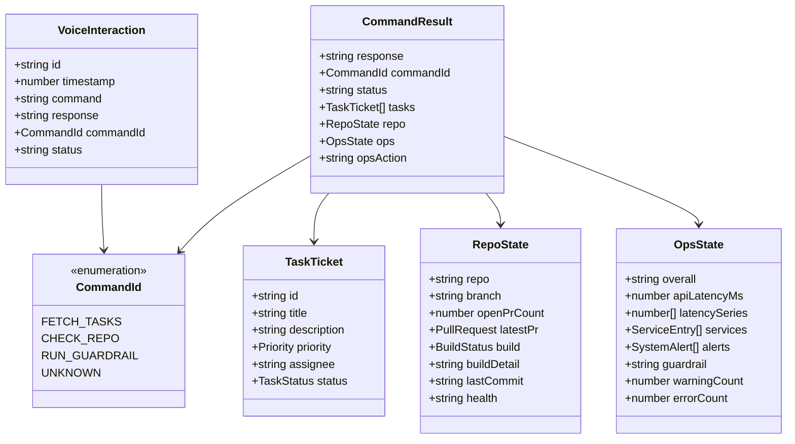
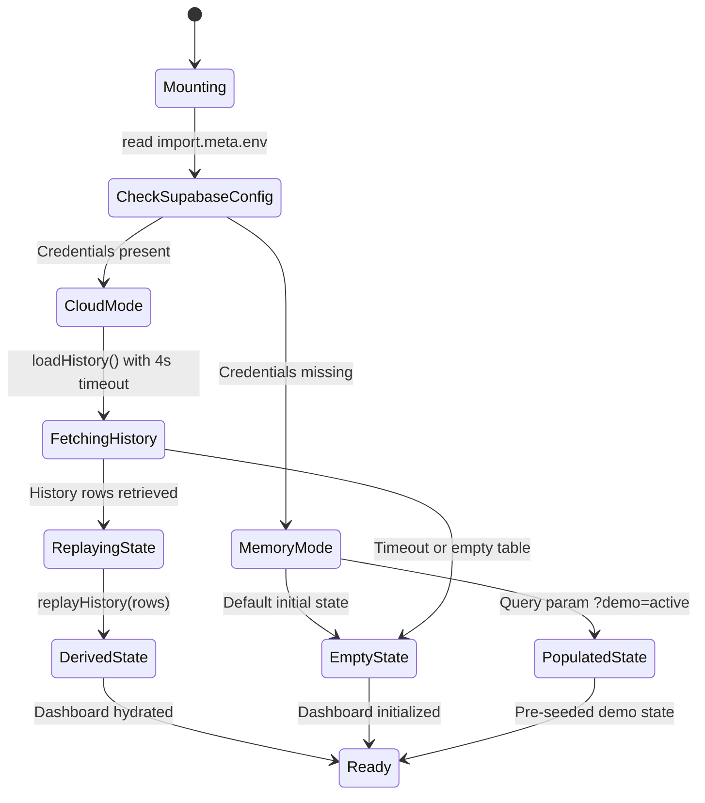

# DevPulse System Architecture & Technical Specifications

This document details the architectural design, component model, data flow, and protocol specifications of **DevPulse** — a voice-driven developer operations portal inspired by Alexa+ and patterned after the Model Context Protocol (MCP).

---

## 1. High-Level System Architecture

DevPulse connects developer workflows across three critical operational domains into a unified interface:

```mermaid
flowchart TD
    subgraph Client["Presentation Layer (React 18 + TypeScript + Vite)"]
        UI["Obsidian Pulse UI Canvas"]
        Console["FloatingCommandConsole<br/>(Voice & Text Dispatcher)"]
        Feed["VoiceLinkFeed<br/>(Transcript & Waveform)"]
        
        subgraph DomainPanels["Operational Panels"]
            Sprint["SprintCriticals<br/>(Issue Tracker Triage)"]
            Git["GitPulse<br/>(CI/CD & PR Health)"]
            Ops["OpsSentinel<br/>(Latency & Security Guardrail)"]
        end
    end

    subgraph CoreEngine["Simulation & Protocol Layer"]
        Engine["commandEngine.ts<br/>(Deterministic Intent Classifier)"]
        Types["types.ts<br/>(Typed MCP Domain Contracts)"]
        StateReplay["persistence.ts<br/>(replayHistory() Reducer)"]
    end

    subgraph Storage["Persistence & External Services"]
        SupabaseClient["supabaseClient.ts<br/>(Optional Cloud Storage)"]
        DB[("Supabase PostgreSQL<br/>voice_interactions")]
        MemoryFallback[("In-Memory State Store<br/>(Zero-Config Fallback)")]
    end

    UI --> Console
    Console -->|Raw Command String| Engine
    Engine -->|Normalized Regex Matching| Types
    Engine -->|CommandResult Payload| StateReplay
    StateReplay -->|State Updates| DomainPanels
    Engine -->|Interaction Record| Feed

    StateReplay -.->|async saveInteraction()| SupabaseClient
    SupabaseClient -->|withTimeout(4000ms)| DB
    SupabaseClient -.->|No Env / Offline| MemoryFallback
```

---

## 2. Request & Command Lifecycle

DevPulse separates command input from domain execution. All commands flow through an asynchronous dispatch lifecycle that gives real-time tactile visual feedback (audio waveform simulation) while maintaining consistent state across reloads.

```mermaid
sequenceDiagram
    autonumber
    actor Developer as User / Voice Command
    participant Console as FloatingCommandConsole
    participant App as App.tsx (State Orchestrator)
    participant Engine as commandEngine.ts
    participant Feed as VoiceLinkFeed (Waveform)
    participant Supabase as Supabase Client

    Developer->>Console: Enter voice/text command (e.g. "Alexa, get assigned tasks")
    Console->>App: onSubmit(command)
    App->>Feed: startWaveform() [Audio Level Simulation: 80ms interval]
    App->>App: Set processing = true

    Note over App,Engine: Simulated MCP processing latency (750ms)
    App->>Engine: processCommand(normalizedCommand)
    Engine->>Engine: recognizeCommand() regex evaluation
    Engine-->>App: CommandResult { response, commandId, status, tasks/repo/opsAction }

    App->>Feed: stopWaveform() & Append VoiceInteraction to transcript
    App->>App: Update domain state (tasks / repo / ops)
    App->>App: Set processing = false

    opt Persistence Configured (VITE_SUPABASE_URL set)
        App->)Supabase: saveInteraction() [non-blocking withTimeout 4000ms]
        Supabase-->>App: Acknowledge insert (or log non-fatal warning on timeout)
    end
```

---

## 3. Domain Model & Typed MCP Contracts

The application uses typed interfaces defined in [`src/sim/types.ts`](file:///Users/adibsunasra007gmail.com/Downloads/project/src/sim/types.ts). These contracts model the exact payload shapes expected from a production Model Context Protocol (MCP) tool registry:



---

## 4. Dual-Mode Persistence & Replay Architecture

DevPulse is built with an **offline-first, zero-config architecture**:

1. **Local Memory Mode (Default):**
   * If `VITE_SUPABASE_URL` and `VITE_SUPABASE_ANON_KEY` are not provided, [`src/sim/supabaseClient.ts`](file:///Users/adibsunasra007gmail.com/Downloads/project/src/sim/supabaseClient.ts) falls back to `null`.
   * The application operates entirely in local React state with zero external network requirements.
   * Testing, evaluation, and local demos work immediately upon clean checkout.

2. **Cloud Persistence Mode (Supabase):**
   * When environment variables are configured, the client connects to Supabase PostgreSQL using the public anonymous role.
   * On mount, `loadHistory()` loads the last 50 interactions ordered chronologically.
   * `replayHistory(history)` derives the exact dashboard state by replaying effects in sequence.
   * `withTimeout(promise, 4000ms)` guarantees that slow or interrupted networks never freeze the user interface.



---

## 5. Security Architecture & Threat Model

* **Secret Isolation:** No service-role credentials or private tokens are embedded in client bundles. Only the public anonymous Supabase key is used.
* **Database Row-Level Security (RLS):** Table `voice_interactions` has RLS enabled with explicit `TO anon, authenticated` policies and `CHECK` constraints on `command_id` and `status`.
* **Input Sanitization:** Commands are normalized (stripped of control characters and excessive whitespace) before regex evaluation, mitigating Regular Expression Denial of Service (ReDoS).
* **DOM Safety:** SVG gradient IDs in [`src/components/Sparkline.tsx`](file:///Users/adibsunasra007gmail.com/Downloads/project/src/components/Sparkline.tsx) are dynamically isolated via React `useId()`, avoiding DOM ID clashing across multiple chart instances.
* **Safe Error Handling:** Catch blocks suppress internal database stack traces from reaching user-facing toasts.

---

## 6. Migration Path: Simulated Engine to Live MCP

DevPulse is specifically architected so that transitioning from the local simulation engine to a live MCP daemon requires changing only one file ([`src/sim/commandEngine.ts`](file:///Users/adibsunasra007gmail.com/Downloads/project/src/sim/commandEngine.ts)):

```typescript
// Future Live MCP Client Implementation:
export async function processCommand(raw: string): Promise<CommandResult> {
  const mcpResponse = await fetch('http://localhost:3001/mcp/dispatch', {
    method: 'POST',
    headers: { 'Content-Type': 'application/json' },
    body: JSON.stringify({ prompt: raw, tools: ['jira', 'github', 'datadog'] }),
  });
  return mcpResponse.json(); // Exactly matches the existing CommandResult interface
}
```
All React UI components, waveforms, state reducers, and persistence hooks remain 100% untouched.
