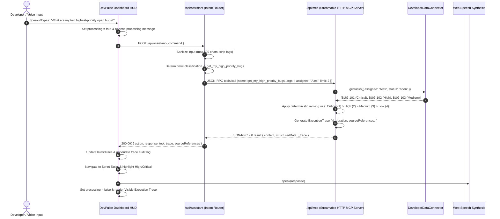

# DevPulse MCP System Architecture & Protocol Specification

This document details the architectural design, component model, data flow, and protocol specifications of **DevPulse MCP** — a voice-driven developer operations command center and Model Context Protocol (MCP) server built for the **Amazon Developer Hackathon’s Alexa+ track**.

Live Deployment: [https://dev-pulse-wine-eta.vercel.app/](https://dev-pulse-wine-eta.vercel.app/)
Target Protocol Specification: **Model Context Protocol (MCP) 2025-11-25**

---

## 1. High-Level System Architecture

DevPulse connects developer workflows across issue tracking, repository health, and monitoring alerts into a unified conversational HUD and a standardized Model Context Protocol server:

```mermaid
flowchart TD
    subgraph Client["Presentation Layer (Next.js 16 + React 19 Client)"]
        UI["Obsidian Pulse Dashboard HUD<br/>(devpulse-dashboard.tsx)"]
        VoiceInput["Web Speech Recognition & Mic Button"]
        SpeechOutput["Web Speech Synthesis (Spoken Answers)"]
        TracePanel["Visible MCP Execution Trace Card"]
        SettingsModal["Settings & Protocol Inspector"]
    end

    subgraph IntentLayer["Intent Understanding & Dispatch (/api/assistant)"]
        Router["Deterministic Pattern Classifier<br/>(Zero-downtime offline fallback)"]
        GeminiRefiner["Google Gemini 2.5 Flash<br/>(Optional semantic classifier)"]
        ArgValidator["Argument Extractor & Schema Bounder"]
    end

    subgraph MCPServer["Official MCP Protocol Server (/api/mcp & server.py)"]
        Lifecycle["MCP Lifecycle: initialize, ping, tools/list, tools/call"]
        TransportHTTP["Streamable HTTP Transport (JSON-RPC 2.0 & SSE)"]
        TransportStdio["Stdio Transport (server.py FastMCP)"]
        ToolRegistry["7 Core Developer MCP Tools Registry"]
    end

    subgraph DataConnectors["Developer Data Connector Layer"]
        Connector["DeveloperDataConnector (data-connector.ts)"]
        DemoFixtures[("Demo Fixture Store<br/>tasks.json · github.json · alerts.json")]
        GitHubAPI[("GitHub REST API v3<br/>/repos/{owner}/{repo}/issues & pulls")]
    end

    VoiceInput --> UI
    UI -->|HTTP POST command| Router
    Router -.->|Ambiguous input & Key present| GeminiRefiner
    Router --> ArgValidator
    ArgValidator -->|JSON-RPC 2.0 tools/call| MCPServer
    MCPServer --> ToolRegistry
    ToolRegistry --> Connector
    Connector -->|Demo Mode| DemoFixtures
    Connector -->|GitHub Mode| GitHubAPI
    Connector -->> ToolRegistry
    ToolRegistry -->> TracePanel
    TracePanel --> UI
    UI --> SpeechOutput
```

---

## 2. Request & Execution Lifecycle

DevPulse enforces an explicit, end-to-end trace for every user interaction. The developer always sees what tool ran, what arguments were sent, what data source was queried, and where the information came from:



---

## 3. Supported MCP Protocol Operations

The HTTP endpoint at `/api/mcp` implements the **MCP 2025-11-25** specification:

| Method | Endpoint | Protocol Operation | Supported Transport |
| :--- | :--- | :--- | :--- |
| `GET` | `/api/mcp` | Server capability & tool discovery | Standard JSON or SSE (`Accept: text/event-stream`) |
| `POST` | `/api/mcp` | `initialize` (Capability negotiation) | JSON-RPC 2.0 (`application/json`) |
| `POST` | `/api/mcp` | `ping` (Liveness probe) | JSON-RPC 2.0 |
| `POST` | `/api/mcp` | `tools/list` (Tool schema discovery) | JSON-RPC 2.0 |
| `POST` | `/api/mcp` | `tools/call` (Tool execution) | JSON-RPC 2.0 |
| `OPTIONS` | `/api/mcp` | CORS preflight headers | HTTP 204 No Content |

---

## 4. The 7 Core Developer Tools

1. **`list_repository_issues`**: Retrieves repository issues with status, assignee, label, and limit filters.
2. **`get_my_high_priority_bugs`**: Flagship demonstration tool answering *"What are my two highest-priority open bugs?"* Ranks tickets deterministically: Critical > High > Medium > Low.
3. **`list_pull_requests_needing_attention`**: Identifies PRs blocked by failing checks or waiting on code reviews.
4. **`summarize_recent_activity`**: Summarizes recent commits with short hashes and author attribution.
5. **`search_technical_documentation`**: Searches supported technical documentation (MCP, Next.js, GitHub REST).
6. **`get_repository_health_summary`**: Calculates overall repository health score based on CI checks and alerts.
7. **`recommend_next_action`**: Suggests top read-only engineering investigations with justifications.

---

## 5. Security & Isolation Model

* **Read-Only Least Privilege:** All 7 tools are query-only; destructive operations cannot be executed via MCP.
* **Prompt Injection Defense:** Commands are bounded to 500 characters, wrapped in system delimiters, and evaluated by deterministic pattern matchers that ignore jailbreak instructions.
* **Credential Isolation:** No tokens, API keys, or private environment variables are returned in tool results or client bundles.
* **Input Validation:** Tool arguments are validated against JSON Schemas; missing required parameters trigger protocol-compliant `-32602` error codes.
